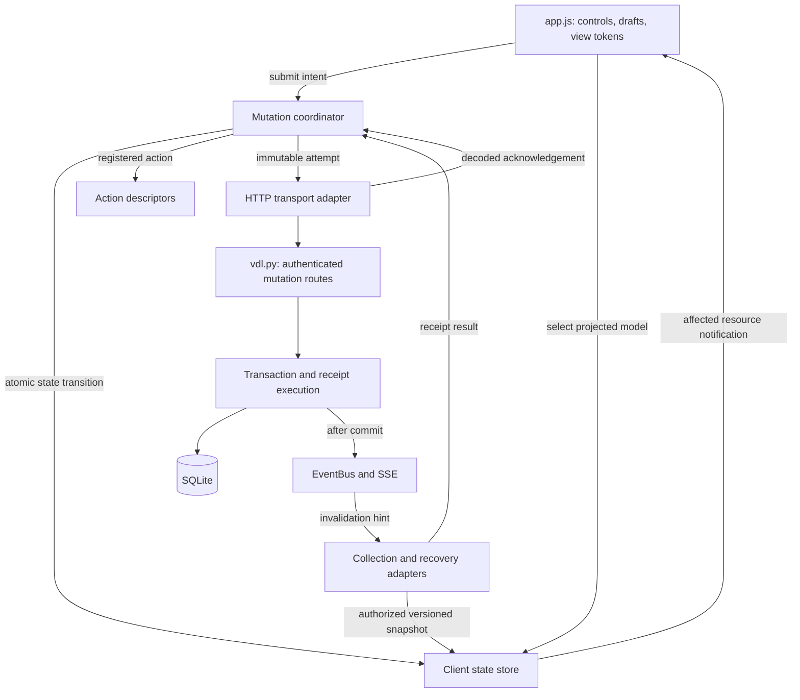

# Architecture: immediate feedback for server-backed interactions

**Status:** Foundation, tags, favorites, rename, preferences, playlist editor saves, playlist add/delete, download commands, and new-download acceptance implemented; additional adapters remain proposed.\
**Date:** 2026-11-09\
**Requirements:** [Feature 0051](../FEATURES/feature-0051-immediate-feedback-for-server-backed-interactions.md)

## Purpose and document ownership

Define the implementation seams for immediate local feedback, canonical server
acknowledgements, and safe reconciliation across VDL's server-backed UI actions.
Tags are the first complete adapter; favorites, settings, playlists, and server
commands exercise the same lifecycle with their own presentation policies.

Feature 0051 owns user-visible behavior, action policies, wire contracts,
operational limits, and acceptance criteria. This document owns proposed module
responsibilities, state ownership, algorithms, persistence, and integration order.
Keep changes to those responsibilities here and link to the feature for its
detailed requirements. If implementation requires changing a requirement, update
the feature explicitly rather than silently contradicting it here.

The implementation adds the shared modules, tag protocol, and independent
`favorite.set`, `rename.set`, `preference.set`, `playlist.create`,
`playlist.replace`, `playlist.add`, `playlist.delete`, and `download.*` adapters described
below. Other actions still use handlers and collection snapshots in
`static/app.js`, server routes and persistence in `vdl.py`, and SSE hints that
trigger collection reads. The [rollout inventory](feature-0051-rollout.md) records
which adapters remain staged. Existing
download statuses, worker lifecycle, playlist sequencing, rotation membership,
and authorization rules remain authoritative during migration.

## Architecture and dependency direction



The state store owns presentation data and deterministic merging. The coordinator
owns mutation execution. The UI owns DOM, focus, and unsubmitted drafts. Server
transactions own truth and authority. No dependency flows from a shared client
module back into DOM-specific code; injected notifications provide that seam.

SSE supplies invalidation, not transport-level delivery guarantees. A successful
mutation response can finish local confirmation with SSE disconnected. Background
reconciliation may still use the existing batching delays.

## Module responsibilities and proposed placement

The client modules below host tags, favorites, rename, preferences, playlist actions, download commands, and new-download submissions. Additional action adapters
remain staged. The client remains raw browser JavaScript;
new scripts expose factory functions through one `window.VDL` namespace and load
in dependency order before `app.js`. No bundler or runtime package is required.

| Module / proposed location | Owns | Interface callers use |
| --- | --- | --- |
| Client state store, `static/client-state.js` | Confirmed domain state, pending projections, version merging, membership generations, availability fences, and affected-resource subscriptions. | Read-only selection/subscription for UI; a restricted writer seam for the coordinator and snapshot adapters. |
| Mutation coordinator, `static/mutations.js` | Intent lifecycle, per-domain queues, immutable attempts, duplicate suppression, response classification, receipt recovery, and cleanup. | `submit`, `status`, `recover`, `resolve`, and authentication reset. |
| Action registry, initially `static/mutations.js` | Trusted action descriptors for tags and later actions: validation, conflict domain, pure projection, request encoding, and response decoding. | Action names and values; UI does not configure transport or rollback. |
| Tag identity helper, `static/tag-identity.js` | Versioned normalization and identity parity needed to merge provisional and canonical tags. | Canonical candidate identity and local validation, including helper version. |
| UI adapters, `static/app.js` | DOM events, drafts, view tokens, projected rendering, accessible status, and existing collection/SSE integration. | Narrow calls into coordinator/store; no independent mutation state machine per control. |
| Server execution helpers, `vdl.py` | Transactional authorization, receipt lookup, expected revision checks, mutation, canonical result construction, and receipt commit. | Route helpers operating on an explicit connection and authenticated actor. |
| Server read adapters, `vdl.py` | Authorized, consistent domain snapshots, capabilities, and receipt recovery. | Existing collection responses plus the targeted reads specified in Feature 0051. |

Keep backend helpers in the existing backend file for initial delivery. Extract
a backend module only when it has a concrete responsibility and test seam; a
new transport architecture does not require reorganizing the whole backend.

## Client state ownership

### State store

The store has four logically separate records:

| Record | Key | Contents |
| --- | --- | --- |
| Confirmed domain | Resource ID and domain | Value, server revision, and availability context. Tags and favorite state are independent domains. |
| Pending presentation | Intent ID | Action, desired value, submission order, lifecycle status, and canonical/provisional presentation key. |
| Collection membership | Collection/scope identity | Accepted request generation, ordered member IDs, and rotation generation when relevant. |
| Availability fence | Resource ID | Generation after a known deletion or authorization loss; older requests cannot reintroduce it. |

The store derives a projected model by folding eligible intents over confirmed
state in submission order. Pure descriptor projectors apply desired operations
idempotently: an add for an already present canonical key still has one chip;
a pending removal has a retained status row but no effective membership.

The UI receives immutable/read-only models with presentation status. It cannot
mutate confirmed snapshots through returned references. A projector has no
network, DOM, timer, or server-side effect. Selecting and rendering a model
therefore cannot repeat a write.

### Coordinator

The coordinator retains execution metadata separately: queue position, active
request, frozen request fingerprint, operation ID, receipt result, and captured
authentication epoch. It updates presentation through the store's writer seam;
the UI never owns a second copy of pending execution status.

One transition updates runtime metadata and store data synchronously and emits
notifications only after the transition completes. No `await` occurs between
accepting a canonical result and removing its corresponding pending projection.
Queue dispatch runs after that transition, against the resulting confirmed
revision. This provides atomic presentation in JavaScript's event loop without
requiring a new concurrency framework.

### Drafts and view tokens

`app.js` retains draft content, selection, and editor/dialog identity. A submit
captures a view token and the submitted draft generation. The UI transfers that
draft into intent presentation and clears only that generation synchronously.
The first local render precedes any wait for transport.

Callbacks may restore focus or edit a draft only when the originating view token
is still current. Saving a tag and reopening Info are independent operations;
the save continues while Info is closed, and an old callback cannot reopen it.
Recoverable text belongs to its failed intent until the user explicitly moves
it back into a suitable draft. It never replaces newer typing automatically.

## Interfaces and action adapters

An illustrative UI call remains small:

```javascript
const submission = mutations.submit({
    kind: 'tag.add',
    targetId: downloadId,
    value: draft.value,
    viewToken: draft.viewToken,
});

const model = clientState.selectDownload(downloadId);
const status = submission.accepted ? mutations.status(submission.intentId) : null;
```

`submit` returns `{ accepted: true, intentId }` immediately on admission, or
`{ accepted: false, reason, message }` when validation, availability, capabilities,
or queue limits prevent admission. The UI clears a draft only on acceptance;
otherwise it retains the draft and renders the message as text. An accepted
canonical duplicate may return the existing intent ID rather than create work.
An already satisfied value with no active intent gets a settled local intent
result and no network write. Admission does not claim server persistence.

An internal descriptor supplies these operations:

| Descriptor responsibility | Contract |
| --- | --- |
| Validate and identify | Produce a desired operation and deduplication identity using the action's rules. Server validation remains mandatory. |
| Choose domain | Resolve the resource/domain queue, such as `(downloadId, tags)`. |
| Project | Purely derive presentation from confirmed state and intent; never save a whole-object rollback copy. |
| Encode | Freeze method, registered same-origin route, payload, mutation ID, and expected revision when dispatched. |
| Decode | Check target, mutation correlation, domain, result shape, outcome, and revision. |
| Recover | Declare whether receipts, job acceptance, or an existing domain-specific sequence establish safe recovery. |

Use explicit desired values for scalar edits, not deferred “toggle” operations.
The tag and favorite adapters can share scheduling while retaining separate
projectors. A download-command adapter shows request status rather than
projecting a completed worker transition. Sensitive edits keep confirmed access
state separate from the requested change. Those are action policies, not a flag
that lets callers optimistically set arbitrary model properties.

Existing playback progress/selection sequences remain specialized adapters or
explicitly documented exceptions. Preserve their ordering and lease contracts;
do not force high-frequency progress into a queue intended for human edits.

## Core algorithms

### Submit and dispatch

1. Validate action registration, capability support, local input, availability,
   and queue admission. Canonical duplicate intent is a no-op with existing status.
2. Record the accepted intent and its projection in one transition. Notify the
   affected resource immediately; preserve its stable chip/card key.
3. If its domain has no unsettled transmitted attempt, dispatch the queue head.
   Capture the latest confirmed revision, authentication epoch, operation ID,
   and immutable encoded request. IDs are created at dispatch, so time spent
   queued does not consume the replay window.
4. Decode the response through its descriptor and transition using the rules
   below. A transport error does not imply server rejection.
5. Release the next eligible intent only after the prior attempt is settled
   or safely resolved. A conflict or unknown outcome pauses that domain while
   other domains and local draft editing remain usable.

### Accept an authorized snapshot

1. Reject results from obsolete authentication epochs or requests fenced by
   known resource unavailability.
2. Compare each adopted domain revision numerically. Accept a higher revision;
   ignore a lower one. Equal revisions must carry equal domain values; a
   mismatch is a protocol error requiring targeted reconciliation.
3. Apply collection membership only if its scope and request generation remain
   current. Item field revisions cannot establish collection membership.
4. Recompute projections for changed resources with all remaining eligible
   intents. Notify affected views once for the batch.

Collection absence is ambiguous for filters, pagination, and rotation. A
targeted authorized read resolves availability; it is never inferred solely
from an entry disappearing from a collection response. Resource identity,
domain revision, membership generation, and editor token serve different
purposes and cannot substitute for one another.

### Accept an acknowledgement

1. Validate correlation, captured epoch, target availability, and decoded outcome.
2. For commitment, merge its canonical domain result only if its revision is
   eligible. Retire the matching intent in the same transition. A newer known
   remote revision stays authoritative over an older successful receipt.
3. For definite rejection, remove only this intent's contribution and retain
   recoverable presentation. Other pending projections and newer drafts survive.
4. For conflict, retain the desired intent, accept authorized newer state, and
   pause the domain for explicit resolution. A deliberate retry is a new attempt.
5. For an unknown outcome, keep its presentation and freeze its attempt for
   receipt recovery. A malformed 2xx response follows this path too.

An SSE-triggered read may show the new tag before its HTTP response arrives.
Canonical identity coalesces the chip, while its intent keeps pending status
until an acknowledgement/receipt establishes that attempt's outcome. Snapshot
content alone does not turn into an invented receipt.

### Recover an unknown outcome

Look up the actor-scoped receipt through the registered recovery adapter. A
committed/rejected receipt uses the same acknowledgement transition as the
original response. Missing receipts remain ambiguous. Within the feature's
replay window, recovery may repeat the exact frozen request and ID through the
receipt contract; automatic replay remains opt-in and action-specific.

An unknown attempt can release its domain only after a receipt, a newer domain
revision that prevents the original conditional write, or the serialized
expired-attempt check described in Feature 0051. Dismissing a status message or
aborting `fetch` does not establish cancellation. Retrying with a new ID is a
new user operation, not transport recovery.

## Server transaction and persistence design

### Execution seam

All adopted database mutations enter one transaction executor, parameterized
by a trusted server action adapter. Route helpers parse the request and supply
actor identity; transaction helpers receive the already open connection.
They must not recursively acquire `_db_lock` or call convenience functions
that open and commit a second connection.

The serialized transaction performs:

1. Resolve current actor suspension, session version, roles, target visibility,
   and applicable edit permission using the transaction's current database view.
2. Look up this actor/mutation ID. For a matching fingerprint, return the
   authorized recorded outcome; a different fingerprint is a conflict.
3. For a new attempt, validate its admission time, payload, and expected domain
   revision. Record a definite decline only when no domain mutation committed.
4. Apply the operation, advance its domain revision if values changed, and
   construct the canonical domain snapshot from that same transaction.
5. Record the receipt and commit it atomically with the domain change.
6. Publish the authorized or generic invalidation hint after commit. Publishing
   failure cannot change the committed outcome into a rejected save.

Replay lookup precedes revision validation because a successful replay carries
the attempt's original, now-old expected revision. Authentication and current
authorization precede returning cached payloads. The existing global write
serialization remains the initial execution seam; any future concurrency change
must retain atomic duplicate detection and conditional writes at SQLite level.

Audit lock ordering with existing rotation and worker operations before adding
calls across these helpers. Do not hold the database write lock during external
network activity, media processing, or a browser round trip.

### Persistent records

| Record | Required design |
| --- | --- |
| Domain revisions | Persistent counters for adopted editable domains, added by migrations. All writers advance the relevant counter. Download progress does not advance the tags counter. |
| Mutation receipts | Unique `(actor ID, mutation ID)`, action/target binding, deterministic request fingerprint, outcome, canonical domain revision/result, and retention metadata. Index actor/ID lookup and cleanup time. |
| Job acceptance, when an action needs it | Durable accepted job identity and recovery state, atomically related to its receipt. Execution progress belongs to the job's existing domain. |

Receipts retain only the data needed for outcome recovery. Sensitive payloads
remain protected by current authorization on every lookup/replay. Cleanup uses
the feature's bounded retention/admission policy; quotas reject new admissions
rather than evict records that still protect an active replay window.

Short database mutations need no committed “in progress” receipt: the data and
final receipt become visible together. Separate jobs need a committed acceptance
record before asynchronous execution. Filesystem rename and process launch need
their own journal/recovery design before replay can be enabled; a database
receipt cannot by itself provide atomic external side effects.

Read adapters return values and revisions from one explicit read transaction.
The ordinary `db()` helper's connection lifecycle alone is not a declaration
that several SELECTs share the necessary read snapshot; the implementation must
establish and test it. Preserve connection-per-call/thread conventions.

### Download command acceptance and worker ownership

The `download-command` domain registers pause, unpause, stop, retry, and resume
as status-only intents. Its decimal-string command revision and current attempt
identity form the conditional acceptance boundary. History submissions retain
the clicked attempt identity rather than substituting the latest worker.
Acknowledgements retire request delivery without projecting a worker transition
or changing collection membership. Existing SSE reads reconcile actual progress.

The server commits a durable command identity and actor-scoped receipt before
dispatch. Retry and resume create their single linked attempt in that same
transaction. Command dispatch shares the filesystem and scheduler serialization
boundary with legacy controls and checks its accepted generation before effects.
Retry cleanup runs outside the database write lock. A durable dispatch claim
prevents replay from repeating ambiguous cleanup or launching another worker.
Restart interrupts vanished work and unfinished dispatch rather than assuming a
thread survived or starting a replacement. Authorized receipt lookup reports
the command's current execution outcome separately from its recorded acceptance.
Shared receipt pruning retains records still needed by active work.
Worker cleanup and legacy Resume serialize flag ownership with the scheduler:
old flags are cleared at handoff, and an unwinding worker cannot erase a pause
accepted for its queued successor.

The existing coordinator serializes contradictory commands per work item. Stop
can wait visibly behind a transmitted pause, including an unknown pause; only
safe outcome recovery releases it. The UI keeps pending/recovery status in
Current, Library, History, and a compact summary. Legacy capability fallback has
delivery feedback without receipt replay. Authentication and access fences cover
command callbacks and History reads. Upload transfer, playback, and scheduling
keep their specialized sequences.

### New-download acceptance

Feature 0058 registers `download.submit` in the independent
`download-submission` domain. Its affected surfaces are the Download dialog and
an in-memory recovery summary. A stable local operation key identifies one
submission; URL equality never identifies a job. The coordinator guards an
unresolved submission while the UI retains newer URL/options drafts and dialog
generations independently. Presentation describes delivery only and does not
create a playable placeholder or project worker progress.

The trusted descriptor sends `POST /api/download` with `client_mutation_id`,
`url`, and optional `format` and `filename`. Creation has no expected resource
revision. Its decoder requires the matching mutation identity and domain,
`accepted` outcome, decimal-string submission revision, and consistent download,
attempt, and job identities. A definite rejection has no job. Unsupported
servers retain delivery feedback without receipt replay.

The existing `download_commands` ledger also records the `submit` action.
Current authorization, selected-option validation, the new download, its single
History attempt, durable job, and actor-scoped receipt share one transaction.
The fingerprint binds the exact submitted URL/options; receipt presentation
contains identities rather than submitted URLs or credentials. Dispatch uses
the existing scheduler boundary and claims ownership durably before enqueueing,
outside the database write lock. Restart exposes interruption without creating
a replacement attempt. Current and History snapshots expose the linked job.

Recovery checks current session and target authorization, returns the same job,
and reports its current execution status separately from acceptance. Deliberate
replay uses the frozen request and original mutation ID. Shared retention,
quotas, replay-window admission, and serialized expired-absence finality apply;
matching collection reads never confirm an unknown submission. Authentication
reset and known target unavailability fence obsolete callbacks. Upload and
companion transports retain their specialized sequences.

### Rename filesystem recovery

The `rename.set` adapter uses an independent persistent rename revision and a
filesystem journal in `vdl.py`. Unlike the tag/favorite transaction executor,
it commits durable preparation before filesystem effects and publishes the
canonical identity together with its final receipt afterward. The journal
binds the actor and frozen request fingerprint to source identity, destination,
and recovery phase. A synchronized hardlink anchor pins the intended file;
exclusive destination creation prevents collision overwrite. Source retirement
uses an exclusive move to a journal-owned path before checking identity, so a
replacement at the old name is never blindly unlinked. Restart and
authorized receipt recovery resume the original operation. Ambiguous identity
requires intervention and retains the operation rather than claiming success.

A file-operation lock serializes rename with removal, including aliases.
Filesystem work runs outside the SQLite write lock. Database phases recheck
current authorization and expected identity before publication. Active journal
admissions survive terminal receipt cleanup. The public recovery response
contains canonical editable state or a generic unresolved status, never raw
journal paths. The UI projects requested display text while retaining confirmed
file identity; only a canonical acknowledgement changes that identity.

### Preference transactions and runtime reconciliation

`preference.set` targets the existing installation-wide save scope, retaining
its authenticated-user authorization. The shared store owns canonical values
and decimal-string revisions; pending intent is status only. Settings owns
draft generations and view tokens, including the local theme preview. A save
acknowledgement applies canonical values without a collection read. Conflicts
require review and explicit submission of the current draft as a new attempt.

Database triggers cover every preference writer. Short preliminary admission
precedes directory validation and rotation membership preparation outside the
database write lock; the final transaction repeats current authorization,
receipt, namespace, revision, expiry, and quota checks. It atomically commits
the settings, accepted rotation deck/deadline, runtime-pending marker, and
terminal receipt. Directory creation is an idempotent prerequisite and can
leave an empty directory after a precommit crash.

Runtime reconciliation uses the latest durable desired configuration under
the existing worker and rotation locks. It configures bandwidth, schedules
the stored rotation deadline, and wakes existing queued work using established
worker-ownership guards. The marker clears only for the reconciled revision;
failure leaves it pending for authorized recovery or startup. Receipt replay
does not generate a new rotation or download command. Startup restores
process-local configuration while retaining the debug reloader's timer-owner
restriction. The [preference effect audit](../FEATURES/feature-0054-immediate-feedback-for-preference-saves.md#preference-effect-audit)
records each boundary.

### Playlist transactions and recovery

The `playlist.create`, `playlist.replace`, `playlist.add`, and `playlist.delete`
descriptors use the existing integer playlist revision and share one conflict
boundary. They retain one unresolved submission per playlist rather than
queuing contradictory writes or later editor drafts. Creation uses an in-memory
editor key until a canonical acknowledgement supplies the server identity.
The editor owns draft generations and view tokens; the shared store owns
confirmed playlist snapshots and status-only intents. Confirmed playback and
rotation ownership do not follow the pending draft.

The serialized database transaction rechecks the current actor/session,
playlist ownership, and member visibility/playability. It binds ordered
membership and submitted options to the shared actor-scoped receipt namespace,
then commits the canonical playlist and receipt together. Matching receipt
replay precedes the original expected-revision check. Authorized recovery
retains the original outcome while redacting member details that are no longer
visible. Quick-add commits membership and its receipt together, including a
confirmed no-op for an already present video. Deletion commits removal and a
receipt containing only the correlated removed identity, terminal revision,
and membership invalidation. A currently authorized actor can recover their
own deletion after the playlist is gone without receiving former private
content. Other playlist receipts still require current live ownership.

Canonical responses merge the affected playlist without a collection refresh.
Collection generations and deletion fences reject older reads and callbacks.
Progress keeps its independent monotonic write sequence: an older membership
acknowledgement cannot replace newer known progress. Retained progress must
still name a visible member, and its resume position follows the accepted order.
Conflicts retain the draft and expose the current authorized ordered list for
explicit review. Unknown outcomes retain their frozen attempt and block another
save in that domain until receipt or finality rules establish safety. Closing
the editor, chooser, or deletion confirmation leaves a compact recovery summary.
Quick-add and deletion show status without projecting membership or removal;
the shelf retains its pending card until canonical deletion installs a removal
fence. Unsupported actions use their legacy endpoints with pending feedback
and no replay. Authentication reset clears editors, recovery state, and prior
callbacks.

## Bootstrap, compatibility, and deployment

Use an authenticated capability read, proposed as
`GET /api/client-capabilities`, once at bootstrap. It returns supported mutation
protocol/action versions, tag identity version, and server time for admission
clock adjustment. It contains no private resource data and uses `no-store`.
Advertise an action only after migrations, all domain writers/read serializers,
receipt execution, and recovery are ready. The health probe retains its
data-free deployment role.

An older server or mismatched identity helper gets conservative pending
feedback through the existing contract. The client does not synthesize missing
revisions or pretend receipt recovery exists. Older clients may keep existing
payloads and response fields; their writes still advance adopted server
revisions so current clients can detect concurrent changes. Preserve existing
playlist revision types through its adapter rather than changing that contract
as a side effect of introducing decimal-string revisions for new domains.

Tag identity data is versioned with the deployed frontend and tested against
the server's normalization. Canonical keys flow through every tag-bearing
snapshot, not just the mutation response. A complete Unicode helper avoids a
second provisional chip when SSE beats HTTP acknowledgement for a case-folded
name. The feature specifies display behavior and compatibility fallback.

The rollout can add new scripts without adding a frontend build. Keep factories
independent of the DOM so Node tests can initialize them with controlled
dependencies. Production initialization in `app.js` injects existing HTTP and
event adapters; tests inject deferred transport and a deterministic clock.

## Security and lifecycle integration

The implementation must satisfy Feature 0051's security requirements. The key
architectural placements are:

| Concern | Enforced at |
| --- | --- |
| Authentication, current permission, CSRF protections | Server request guards and transaction execution, including recovery and replay. |
| No arbitrary request execution | Trusted action registries; UI supplies action name, target, and value rather than a URL or executable callback. |
| Untrusted labels/errors | UI text rendering and existing escaping, including provisional chips before persistence. |
| Account separation | Coordinator/store authentication epoch; reset clears queued intents, private snapshots, drafts, and recovery presentation. |
| Known access loss/deletion | Store availability fence plus server authorization; pending intent never revives the resource. |
| SSE privacy | Event publication/delivery; generic invalidation or authorized recipient filtering, with no broadcast receipts. |
| Focus, selection, and draft safety | UI view token checks, separate from receipt and revision comparisons. |
| Private-data retention | In-memory client state and bounded authorized server receipts; no persistent browser write queue. |

Reset advances the authentication epoch before canceling waits or clearing views.
A late callback captured in the old epoch cannot confirm, retry, render, restore
focus, or dispatch the next request. Already submitted server work still follows
the server's authorization and commit contract.

Observe timing and outcome metadata at the coordinator/executor seams. Measure
local presentation separately from acknowledgement latency and background
refresh latency. Logs contain action/outcome/correlation data, not raw tags,
drafts, filesystem paths, or credentials.

## Implementation sequence and verification seams

| Stage | Concrete completion condition |
| --- | --- |
| Store and coordinator | Deterministic seam tests cover both GET/acknowledgement orders, pending projection, domain queues, draft-independent results, and epoch reset. |
| Tag persistence protocol | Migration, current authorization, conditional writes, all tag writers, consistent snapshots, receipt deduplication/expiry, and legacy-client tests pass before capability advertisement. |
| Tag UI adapter | Real Info interaction shows the chip/spinner before transport completes, accepts the next draft, survives reconciliation, and confirms with SSE blocked. |
| Recovery and lifecycle | Lost-response-after-commit, conflict, denial, logout, resource disappearance, and stale callbacks are covered through the same production interfaces. |
| Additional adapters | Each action's presentation/side-effect/recovery contract and test evidence are entered in the feature's completion inventory before conversion. |

The test seam is the public interface used by production callers. Store and
coordinator tests use controlled transport rather than copies of application
functions. Server tests exercise actual transactional mutation routes and
recovery, including concurrent duplicate requests and crash/failure injection.
Browser tests cover integration details the pure seam cannot: retained DOM,
spinner slot dimensions, event propagation, keyboard handling, accessible
announcements, and focus. The feature lists the full acceptance matrix and
the repository's required coverage gate.

Initial delivery ends when the complete tag adapter and its protocol meet that
matrix. The wider app migration ends only after every mutating interaction has
an adapter or a documented domain-specific mechanism with immediate feedback
and safe recovery. New infrastructure alone is not a completed UI feature.
