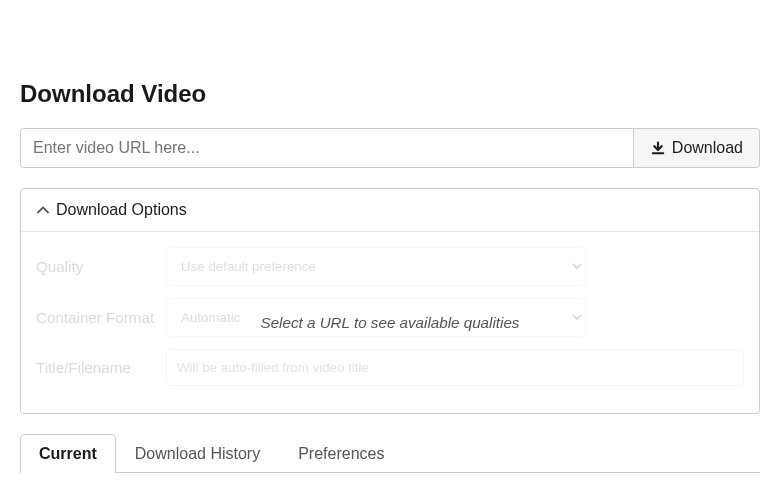

# VDL

A lightweight local video-downloader UI powered by yt-dlp. VDL provides a
browser interface for choosing formats, tracking concurrent downloads, pausing
or resuming work, importing local videos by dropping them onto the page,
organising entries with tags, and playing completed media.
Live progress arrives over Server-Sent Events without browser polling.
The UI and media APIs require a signed-in user.

[](https://github.com/mnemonic-bit/VDL/releases/latest)
[](https://github.com/mnemonic-bit/VDL/actions/workflows/main.yml?query=branch%3Amain+event%3Apush)
[](LICENSE)
[](https://github.com/mnemonic-bit/VDL/pkgs/container/vdl)



VDL is intended for a trusted local operator. It stores history and preferences
in SQLite, writes media to a configurable directory, supports light and dark
themes, and ships as a hardened non-root container for `linux/amd64` and
`linux/arm64`.

Built-in **Play All** and **Shuffle** prepare the next stored video around ten
seconds before the current one ends and blend picture and sound over the final
three seconds when the browser is ready. Pausing freezes the overlap; volume,
mute, and playback speed apply to both videos. Use **Fullscreen** or **F** to
keep both pictures inside one fullscreen stage. Reduced motion switches the
picture immediately while retaining the audio fade. When buffering or browser
playback restrictions prevent an overlap, the current video finishes before
the usual handoff and recovery controls appear. Playlists, direct playback,
and native WebKit video fullscreen retain their existing handoff.

## Download limits

Settings controls the total number of URL downloads (default **3**) and the
number from one source hostname (default **2**). Additional URLs wait in
Current downloads without occupying a worker thread. A busy server does not
block eligible jobs from another server. Paused downloads retain their slots;
Stop removes waiting jobs and Continue joins the end of that server's queue.
Both limits apply across all users, and changes take effect immediately
without stopping active downloads.

**Maximum total download speed (Mbps)** shares one media intake budget across
all URL downloads, including audio/video streams, fragments, retries, and
resumed work. **0** means Unlimited; **8 Mbps** is about **1 MB/s**. The limiter
allows up to one second of burst credit. It excludes playback, uploads,
imports, and the New download dialog's metadata probe. Changing the speed
updates running native transfers. Transfers that require an external media
downloader, including live HLS delegated to ffmpeg, report an unsupported
transfer error while a cap is enabled. Enabling a cap during an external
transfer stops that job with the same error; local ffmpeg post-processing
continues to work.

## Prerequisites

The recommended deployment needs Docker Engine with Compose. Podman works with
a Compose provider. Native use needs Python 3, the packages in
`requirements.txt`, and ffmpeg/ffprobe. A current Chromium, Firefox, or WebKit-
based browser is sufficient for the UI; browser playback still depends on codec
support in that browser.

The footer shows the release observed in the loaded UI and the release reported
by the active API. A mismatch asks you to refresh, which makes stale pages or
mixed deployments visible. The server also prints both values to its console
when it starts. Maintainers update the root `VERSION` file when cutting a
behavior-changing release according to the policy in `AGENTS.md`.

## Run with Docker Compose

The default deployment publishes port 5000 on all host interfaces and stores
media and SQLite state in independent named volumes:

```bash
docker compose up --build -d
docker compose ps
curl --fail --silent http://127.0.0.1:5000/api/health
```

Open <http://127.0.0.1:5000>. Set `VDL_PORT` to change the host port without
changing the container's health check:

```bash
VDL_PORT=8080 docker compose up --build -d
```

Stop containers with `docker compose down`. This preserves `vdl-data` and
`vdl-downloads`; `docker compose down -v` intentionally deletes both volumes.

### Import mounted files at startup

Compose mounts the repository's `./ingest` directory at `/ingest` read-only.
On startup, VDL takes one recursive snapshot of eligible files in that mount
and imports each captured file at most once. Imported videos appear in the Library
as local uploads; the original files stay in `./ingest`. A movie at
`./ingest/Family/Trips/movie.mp4` receives the tags `Family` and `Trips`.
Files directly under `./ingest` receive no folder tags. Folder names follow
the normal tag rules: invalid names cause that file's import to fail with a
logged error, while other files continue.

Finish writing each file before starting VDL. For an atomic handoff, write a
temporary or hidden name in the same destination subfolder, close it, then
rename it to its final name before VDL starts:

```bash
cp /path/to/movie.mkv ./ingest/Family/.movie.mkv.part
mv ./ingest/Family/.movie.mkv.part ./ingest/Family/movie.mkv
docker compose up --build -d
```

VDL ignores hidden files and subfolders, symlinks, and names ending in
`.part`, `.partial`, `.tmp`, `.crdownload`, or `.download`. It checks source
identity before and after copying and validates video content with `ffprobe`.
Files added, renamed, or changed after the startup snapshot require a VDL
restart before they can be considered. There is no timed rescan. SQLite
receipts prevent unchanged imported sources from creating another Library
item across restarts; a changed source can create a new item on a later
startup. Removed source receipts are pruned after a complete startup scan.

Set `VDL_INGEST_HOST_DIR` to bind another host folder. The container needs read
and search permission on the entire directory tree:

```bash
VDL_INGEST_HOST_DIR=/srv/vdl/ingest docker compose up --build -d
```

Native runs opt in by setting `VDL_INGEST_DIR` to a readable directory. An
unset or empty value disables import. A standalone container also requires an
explicit read-only mount and `VDL_INGEST_DIR=/ingest`; the image itself does
not activate importing. The inbox and library output paths must be separate
directory trees.

Imported copies use unique internal filenames, while the Library and browser
downloads show the original filename. History's **Duplicates** view groups
finished library files with identical bytes, including uploads and downloads.
It keeps every item and its tags; deletion remains an individual action.
Indexing older media can take time, and **Refresh duplicate index** checks
stored library files again after external edits. Neither action scans the
ingest mount for new files.

### Library and download History

The main **Library** shows available, completed videos and your playlists.
Failed or incomplete work never becomes a Library card. Open **History** from
the account menu for a separate list of acquisition attempts, or select its
**Duplicates** tab to review identical media. The Library has no view tabs.
The Current downloads drawer remains available from both pages.

History records accepted URL downloads, Firefox companion work, uploads, and
mounted imports, including failures after acceptance. Pause/unpause belongs to
one attempt; Resume and Retry create another attempt on the same download
item. Earlier outcomes survive success and media deletion. Only finished,
available, authorized media gets a thumbnail and **View in Library** action.
History shows each user's own attempts; administrators additionally see
ownerless system imports. Removing an account removes its private attempt log.

History has an independent filter and bounded pagination. Quoted phrases and
all free-text terms must match; `status:error` and other canonical statuses
restrict outcomes. Source references omit embedded credentials and redact
query values except routing identifiers (`v`, `list`, `index`, `t`, `start`,
`end`, `id`, `page`). Diagnostic URLs redact all query values. Browser cookies
and authorization headers are never part of an attempt record. Live changes
use SSE without polling.

In Settings, **Clear History** previews and deletes terminal attempt records
only, leaving active attempts, Library videos, and files intact. **Delete
Library media** is the separate administrator action for removing completed
and failed items and their files; it keeps their attempt snapshots.

Version 0.45.0 changes the internal authenticated collection APIs
incompatibly. These APIs are not officially published; by maintainer decision,
this release uses a feature (minor) version bump:

| Endpoint | Contract |
| --- | --- |
| `GET /api/library` | Array of authorized finished video entries with safe, existing files. Physical paths are not returned. |
| `GET /api/current-downloads` | Array of current entries in `starting`, `downloading`, `paused`, `cancelled`, or `interrupted`. |
| `GET /api/history?filter=...&page=1&page_size=20` | `{items, total, page, page_size}` of personal attempt snapshots, newest first by start time and ID. Pages start at 1; page size is 1–100; an excessive page is clamped. |
| `POST /api/resume/<id>` | New attempt on cancelled/interrupted URL work, preserving partial media. |
| `POST /api/retry/<id>` | New attempt on terminal URL work, using the same download ID and clearing previous media artifacts. Companion work requires fresh submission from Firefox; uploads/imports must be submitted again. |
| `GET /api/clear/preview`, `POST /api/clear` | Administrator preview/delete of terminal attempts, without deleting files. |
| `GET /api/library/clear/preview`, `POST /api/library/clear` | Administrator preview/delete of completed and failed media items and files. |

History items expose IDs, source type/reference, title and basename snapshots,
start/end times, status, progress/bytes/speed/ETA, final size/resolution, error
summary/details, and a `legacy` marker. `library_id` is non-null only for a
finished attempt with currently playable media; `media_state` distinguishes
`available`, `unavailable`, and `removed`. Derived `can_resume`/`can_retry`
capabilities apply only to the latest eligible attempt. `download_id` becomes
null after media deletion. No old mixed-array `/api/history` alias remains.
Existing databases get one best-effort legacy attempt per download, not
invented retry records; startup marks orphaned active attempts interrupted.

### First sign-in and user access

The first visit asks you to set a password for the built-in `admin` account;
there is no preset password. Passwords are stored as one-way Werkzeug hashes.
After signing in, administrators can open **Settings → Users** to add normal or
administrator accounts, rename accounts, suspend or resume access, reset
passwords, and remove users. VDL prevents removal, suspension, or demotion of
the last active administrator. Renaming the bootstrap administrator does not
recreate an `admin` account on restart.

Podman can build and run the same image. A Compose provider (`podman-compose`
or Docker Compose) is required to use `compose.yaml` through Podman.

## Build and run directly

```bash
docker build --pull -t vdl:local .
docker run --rm -p 127.0.0.1:5000:5000 \
  -e VDL_INGEST_DIR=/ingest \
  -v vdl-downloads:/downloads -v vdl-data:/data \
  -v /srv/vdl/ingest:/ingest:ro vdl:local
```

The image contains yt-dlp `2026.08.19`, Deno `2.9.5`, EJS, curl-cffi,
ffmpeg, and ffprobe. It runs through tini as fixed UID/GID `10001:10001` and
does not contain Chromium or a browser automation package.

Published multi-platform images are available from GHCR:

```bash
docker pull ghcr.io/mnemonic-bit/vdl:latest
docker run --rm -p 127.0.0.1:5000:5000 \
  -e VDL_INGEST_DIR=/ingest \
  -v vdl-downloads:/downloads -v vdl-data:/data \
  -v /srv/vdl/ingest:/ingest:ro \
  ghcr.io/mnemonic-bit/vdl:latest
```

`latest` and `main` move. For reproducible deployment and rollback, use an
immutable `v<VERSION>` or full Git commit SHA tag from the
[package](https://github.com/mnemonic-bit/VDL/pkgs/container/vdl). Each
published platform image has GitHub-native provenance and an SPDX SBOM
attestation. Verify them with GitHub CLI:

```bash
gh attestation verify oci://ghcr.io/mnemonic-bit/vdl:v0.4.1 \
  --repo mnemonic-bit/VDL
amd64_digest=$(docker buildx imagetools inspect \
  ghcr.io/mnemonic-bit/vdl:v0.4.1 --raw | \
  jq -r '.manifests[] | select(.platform.architecture == "amd64") | .digest')
gh attestation verify "oci://ghcr.io/mnemonic-bit/vdl@$amd64_digest" \
  --repo mnemonic-bit/VDL \
  --predicate-type https://spdx.dev/Document/v2.3
```

## Optional PO-token provider

The BgUtils plugin is installed but disabled by default. To opt into its
isolated HTTP provider for the whole deployment, enable both the profile and
the application setting:

```bash
VDL_POT_PROVIDER_URL=http://bgutil-provider:4416 \
  docker compose --profile pot up --build -d
docker compose ps
docker compose logs --no-color vdl bgutil-provider
```

The provider has no host-published port. An empty `VDL_POT_PROVIDER_URL` means
plugin discovery is disabled and ordinary yt-dlp behavior is unchanged. PO
tokens may help with some YouTube responses, but they do not bypass access
controls and do not guarantee a successful download.

## Storage, backup, and upgrades

List the concrete named-volume locations with `docker volume inspect`. Back up
both volumes while VDL is stopped; `/data` contains users, password hashes,
session signing state, download history, and preferences, while `/downloads`
contains completed media and resumable partials.

VDL enables SQLite write-ahead logging (WAL) during startup so background
writes can coexist with authenticated reads. Keep the database on a local
filesystem that supports SQLite shared-memory locking; do not put `/data` or
`DOWNLOADS_DB` on NFS or SMB. The database directory must be writable so SQLite
can create its `-wal` and `-shm` sidecar files. Startup fails if WAL cannot be
enabled. See [SQLite's WAL requirements](https://www.sqlite.org/wal.html).

Stop all processes using the database before copying the entire data directory,
including any sidecar files. Copying only `downloads.db` from a running server
can omit committed changes in its WAL. For a live database backup, use the
[SQLite backup API](https://www.sqlite.org/backup.html) instead.

Database lock waits are limited to one second per operation. Unhandled lock
errors, including account lookups, return HTTP 503 with `code: "database_busy"`
and `Retry-After: 1`; account checks still require a fresh database read. The UI
retries affected reads up to twice and displays an error if contention persists.
Actions that change data are never replayed automatically. Slow database
operations and lock failures log the operation, thread, execution/commit
timings, and SQLite result code without SQL parameters.

Upgrades are immutable and reviewed: update image digests and dependency pins,
update `requirements-container.constraints`, regenerate
`requirements-container.txt` for both `manylinux_2_17_x86_64` and
`manylinux_2_17_aarch64`, run `./tests/container/check-lock.sh`, rebuild with
`--pull`, run the smoke checks, then recreate the service. Do not run
`yt-dlp -U`, `pip install -U`, or a Deno updater inside a running container.
Rollback starts the previous image against the same two volumes. Startup
automatically creates the access-control tables when upgrading an older
database.

Bind mounts are supported in place of the named volumes. The data and download
paths must already be writable by UID/GID 10001; the ingest path only needs to
be readable and searchable:

```bash
sudo install -d -o 10001 -g 10001 /srv/vdl/data /srv/vdl/downloads
sudo install -d -o "$(id -u)" -g "$(id -g)" -m 0755 /srv/vdl/ingest
docker run --rm -p 127.0.0.1:5000:5000 \
  -e VDL_INGEST_DIR=/ingest \
  -v /srv/vdl/data:/data -v /srv/vdl/downloads:/downloads \
  -v /srv/vdl/ingest:/ingest:ro vdl:local
```

The entrypoint fails with a clear storage-access error instead of starting a
server that cannot create its database, write media, or read a configured
ingest mount.

## Network exposure

The UI accepts arbitrary operator-supplied URLs and requires a local VDL
account. The Compose port binds to `0.0.0.0`; use strong passwords and still
restrict access to a trusted network or place it behind a hardened reverse
proxy with request limits and an SSRF policy before exposing it publicly. The
login is an application access boundary, not protection against hostile URLs
submitted by an authorized user.

Only download media you are authorised to access and use. VDL does not bypass
DRM or access controls, and operators remain responsible for applicable site
terms and copyright law.

## Verification

The permanent regression suite is split into explicit tiers:

```bash
./tests/run-all.sh --unit
./tests/run-all.sh --browser
./tests/run-all.sh --media
./tests/run-all.sh --container
./tests/run-all.sh --all
```

`--all` is the release gate. See [`tests/README.md`](tests/README.md) for
dependencies, expected-failure policy, and the macOS manual check.

Build and inspect the local image with:

```bash
./scripts/container-smoke.sh --build
```

The script supports Podman through `CONTAINER_ENGINE=podman`. It checks the
runtime UID, pinned yt-dlp version, Deno, ffmpeg/ffprobe, Python extras, and the
absence of a browser. The external regression smoke is intentionally separate
from builds and health checks:

```bash
./scripts/network-smoke.sh |& tee "vdl-network-smoke-$(date -u +%Y%m%d).log"
```

It records the UTC date, image, URL, verbose yt-dlp diagnostics, and result for
the representative `G3jvn7n-68Y` failure. Since public sites change, a later
unrelated removal or restriction should be recorded rather than treated as a
container build failure.

Inspect image health with `docker inspect --format '{{json .State.Health}}'`
or the equivalent Podman command. `/api/health` intentionally remains
unauthenticated for runtime probes, exposes no library data, and does not call
YouTube or the optional provider.

## Native development

```bash
python3 -m venv .venv
source .venv/bin/activate
python -m pip install --upgrade pip -r requirements.txt
python vdl.py
```

Native development defaults to <http://127.0.0.1:5000>. ffmpeg remains an
external system dependency.

## Firefox authenticated downloads

VDL Companion lets a signed-in user send the current Firefox page and the
cookies applicable to that page to VDL with one explicit toolbar click. This
is useful for media the site exposes only to the user's legitimate browser
session. It does not bypass DRM, CAPTCHA, bot protection, geographic or account
authorization, or a site's terms.

Pairing requires desktop Firefox 140 or later. Trusted HTTPS remains the
recommended transport and is required for public addresses. For local use,
plain HTTP is enabled on loopback by default. An operator may explicitly allow
RFC1918 private or RFC6598 shared IPv4 networks with a comma-separated CIDR
list, for example:

```bash
VDL_COMPANION_HTTP_CIDRS=192.168.1.0/24 docker compose up --build -d
```

For this workspace's shared-address subnet, the equivalent is
`VDL_COMPANION_HTTP_CIDRS=100.96.0.0/24`.

Then open the exact private address, such as `http://192.168.1.20:5000`.
Private HTTP sends page URLs, cookies, and the companion token without
transport encryption, so enable it only on a network whose users and traffic
you trust. Hostnames and public IP ranges are intentionally not accepted for
this exception.

For other deployments, put VDL behind an HTTPS reverse proxy and forward
requests to the normal VDL HTTP listener. The public URL may use a non-default port,
for example `https://vdl.example:8443`, but it must have no path prefix.
Install the proxy's private certificate authority in Firefox when using an
internal CA.

For a typical reverse proxy, preserve the original request path and host, allow
long-lived `/api/events` responses without buffering, and proxy the fixed XPI
and `/api/extension/*` paths unchanged. No forwarded-scheme trust setting is
needed for pairing: Settings uses the browser's authoritative
`window.location.origin`.

To use the companion:

1. Open VDL Settings → Browser Extension. For **Install Firefox extension** or
   **Update Firefox extension**, accept Firefox's Add confirmation. For
   **Download unsigned XPI**, follow Settings' temporary-loading instructions
   and repeat loading after Firefox restarts. See the
   [package installation guide](browser-extension/README.md#install-the-bundled-package).
2. Create and copy the five-minute pairing string, paste it into the extension
   onboarding page, verify the exact destination origin, and confirm pairing.
3. Open a signed-in video page and click **Download current page with VDL**.
   Firefox asks for access the first time each website host is used.
4. Install a newer signed bundled XPI when Settings reports an update. The stable
   add-on identity updates the existing installation in place. A compatible
   installed signed extension keeps working when the server bundles an unsigned
   package.
5. Use **Revoke** in VDL Settings or **Unpair** in the extension options to end
   a connection. Signing out of the VDL web UI alone does not revoke it.

Firefox Containers are isolated by the clicked tab's cookie store. Private
windows, partitioned/FPI cookies, related identity-provider domains,
localStorage, custom browser headers, Android/iOS Firefox, and non-Firefox
browsers are not supported. If an authenticated download is cancelled or VDL
restarts, revisit the signed-in source page and click the companion again;
ordinary Continue is intentionally unavailable because cookies are never
persisted. VDL stores the source URL and its query in the downloads database,
while browser cookies remain in the live worker's memory only. See
[the companion privacy notice](browser-extension/PRIVACY.md) for the complete
data-handling disclosure.

## Project status and support

VDL is a sole-maintainer project, released under the [MIT License](LICENSE).
Public issues are available through structured forms for reproducible bugs and
feature requests. Triage and maintenance are best effort, with no guaranteed
response or resolution time; duplicate, unsupported, or insufficiently
actionable reports may be closed. External pull requests and shared governance
are not part of the current maintenance model.

Report vulnerabilities privately according to [SECURITY.md](SECURITY.md), not
through a public issue. Maintainer-only GitHub setup and release safeguards are
recorded in [.github/REPOSITORY_SETTINGS.md](.github/REPOSITORY_SETTINGS.md).

## Future browser provider

This release is browser-ready, not a browser image. Reconsider Chromium only if
a current pinned yt-dlp with EJS, Deno, curl impersonation, and ffmpeg still
fails, the optional provider is demonstrably reached and remains insufficient,
the URL works from a browser on the same network, and the cause is genuinely
browser-solvable rather than DRM, authentication, rate limiting, or removal.
That work needs a separate design for browser concurrency, timeouts, sandboxing,
memory, cleanup, ephemeral cookies, and secret redaction.
